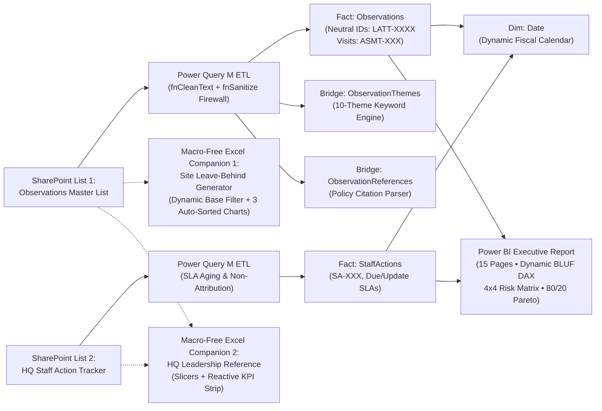
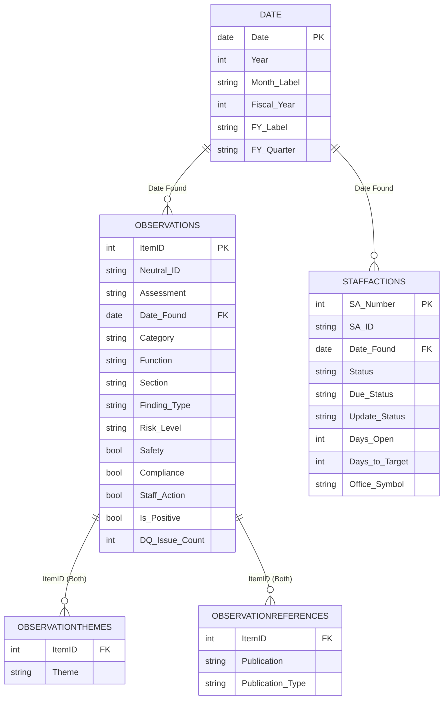

# Program Analytics & Action-Tracking Case Study: Enterprise Operational Assessment Platform

> **Portfolio & Role Note:** All schemas, transformation scripts, DAX measures, and interactive demos in this module are **100% sanitized, unclassified structural artifacts** running on **100% synthetic data** (`[Base Alpha]`–`[Base Echo]`, `ASMT-001`–`ASMT-005`). As **Program Founder & Program Manager** (not a traditional software engineer), I defined the business problems, non-attribution privacy rules, 4×4 operational risk scoring, per-visit normalization, and 180-day SLA governance—then leveraged Power Platform low-code tools and AI-assisted scripting to implement and validate these pipelines without dedicated developer headcount.

---

## Quick Links
- **Interactive Executive Dashboard Mockup (No License Required):** [`demo/executive-dashboard-mockup.html`](demo/executive-dashboard-mockup.html)
- **Interactive Client-Side Non-Attribution Analyzer (With 1-Click Synthetic Demo):** [`sanitized-code/html-prototype/enterprise-anon-tracker.html`](sanitized-code/html-prototype/enterprise-anon-tracker.html)
- **Sanitized Power Query M Pipeline:** [`sanitized-code/power-query/`](sanitized-code/power-query/)
- **Sanitized Power BI Semantic Model (`.tmdl`):** [`sanitized-code/semantic-model/`](sanitized-code/semantic-model/)
- **Sanitized DAX Measure Libraries & Theme:** [`sanitized-code/dax-and-theme/`](sanitized-code/dax-and-theme/)

---

## 1. The Business Problem
Multi-site operational assessments generated hundreds of rich-text field observations, compliance citations, training interventions, and escalated headquarters action items across disconnected SharePoint lists:

1. **Unstructured Field Data Trapped in SharePoint Lists:** Free-text fields contained HTML markup, encoded entities, inconsistent choice spellings, multi-value lookup records, and unstandardized policy citations (`"21-101"`, `"AFI21-101"`, `"DAFI 21-101"`).
2. **Attribution & Psychological Safety Risk:** Senior leadership needed enterprise-wide trend visibility across sites, *without* exposing individual operating locations, unit identifiers, or personnel names in command-wide executive briefings.
3. **No Closed-Loop SLA Visibility:** Systemic issues elevated to headquarters staff lacked automated aging metrics (`Days Open`, `Overdue`, `Due in 30 Days`, `Stale > 30 Days`, `Awaiting First Update`) and reconciliation against field submissions.
4. **Heavy Manual Post-Visit Reporting:** Turning raw list exports into site leave-behind packets, out-brief risk charts, and executive summaries took hours of repetitive manual filtering, HTML cleanup, and chart formatting after every site visit.

---

## 2. End-to-End Architecture & Data Lineage

---

## 3. Star-Schema Semantic Data Model (`.tmdl`)

The Power BI semantic model ([`sanitized-code/semantic-model/`](sanitized-code/semantic-model/)) uses a clean star-and-bridge schema designed for multi-grain analytics without duplicating fact rows:

### Key Modeling Decisions
- **Multi-Label Bridges with Bi-Directional Filtering:** A single field observation can touch multiple operational themes (e.g., *Tool Control* and *Documentation*) and cite multiple directives. Modeling `ObservationThemes` and `ObservationReferences` as normalized bridge tables preserves accurate fact counts (`COUNTROWS(Observations)`) while enabling cross-filtering from any theme or policy citation.
- **Per-Assessment Normalization:** Raw counts skew toward larger sites or longer visits. The ETL dynamically clusters site observations separated by `>30` calendar days into neutral assessment keys (`ASMT-001`, `ASMT-002`, ...) and drops the source site name *before* data enters the semantic model, enabling fair per-visit KPIs (`Deficiencies per Assessment`, `Priority per Assessment`).
- **Dynamic Fiscal Calendar (`Date.tmdl`):** Automatically spans full October–September fiscal years covering all observed dates through the current date, with integer sort keys (`Month Sort`, `FY Quarter Sort`) for proper chronological chart ordering.

---

## 4. ETL & Data Engineering Highlights (Power Query M)

All transformation logic lives in modular, reusable Power Query M scripts ([`sanitized-code/power-query/`](sanitized-code/power-query/)):

| Module | Engineering Problem Solved | Implementation Highlight |
|---|---|---|
| [`02_fnCleanText.m`](sanitized-code/power-query/02_fnCleanText.m) | SharePoint exports mix rich-text HTML, smart quotes, lookup records, and multi-choice lists. | Unpacks records/lists safely, strips HTML tags without regex, decodes 16+ HTML entities, and repairs UTF-8 replacement characters (`65533`). |
| [`03_fnSanitize_Firewall.m`](sanitized-code/power-query/03_fnSanitize_Firewall.m) | Power Query M lacks native regex, yet narrative fields must be scrubbed of units, sites, ranks/names, and emails before loading into the model. | Custom token-level state machine (`List.Generate`) that preserves punctuation while redacting multi-word unit chains, glued unit codes, titles + names, site acronyms, and emails into `[UNIT]`, `[INSTALLATION]`, `[PERSONNEL]`, and `[EMAIL]`. Paired with strict column allow-listing (`Table.SelectColumns`). |
| [`04_fnPublications.m`](sanitized-code/power-query/04_fnPublications.m) + [`08_ObservationReferences.m`](sanitized-code/power-query/08_ObservationReferences.m) | Evaluators cite directives inconsistently (`"AFI21-101"`, `"DAFI-21-101"`, or bare `"21-101"`). | Tokenizes and normalizes legacy prefixes (`AFI → DAFI`, `AFMAN → DAFMAN`), distinguishes technical orders from policy directives, and resolves unprefixed series numbers by joining against the modal (most-frequently cited) prefix across the dataset. |
| [`06_ThemeKeywords.m`](sanitized-code/power-query/06_ThemeKeywords.m) + [`07_ObservationThemes.m`](sanitized-code/power-query/07_ObservationThemes.m) | Leadership needed thematic trend rollups beyond rigid dropdown categories. | Data-driven 10-theme keyword table supporting exact word/phrase and stem-prefix matching against normalized narrative + recommendation text. |
| [`excel-automation/`](sanitized-code/power-query/excel-automation/) | Post-visit Excel leave-behind packets required hours of manual cleanup, filtering, and chart building in macro-restricted environments. | Zero-VBA Power Query pipelines baked directly into `.xlsx` templates: reads a dynamic `tblVisitFilter` cell parameter, strips internal-only nominations, separates Best Practices from HQ Staff Actions, and drives auto-sorted charts. |

---

## 5. Executive KPI, Risk Weighting & SLA Aging Logic (DAX)

The DAX layer ([`sanitized-code/dax-and-theme/`](sanitized-code/dax-and-theme/)) turns raw tables into decision-ready executive indicators:

1. **4×4 Operational Risk Matrix Weighting:** Computes deterministic `High / Moderate / Low` risk levels from `Probability × Severity` (matching enterprise risk governance), plus dynamic hex color measures (`Risk Cell Color`) for native conditional formatting:
   - **High Risk:** `Severe × (Frequent | Likely | Occasional)` or `Significant × Frequent`
   - **Moderate Risk:** `Severe × Unlikely`, `Significant × (Likely | Occasional)`, or `Limited × (Frequent | Likely)`
   - **Low Risk:** Remaining assessed cells
2. **80/20 Root Cause Pareto Analysis:** Dynamically ranks classified root causes inside the current slicer context (`ALLSELECTED`), computes cumulative share (`Pareto Cumulative %`), flags the "vital few" driving the first 80% of deficiencies (`Pareto Core`), and applies dynamic bar highlighting (`Pareto Bar Color`).
3. **Closed-Loop Staff Action SLA & Aging Governance:**
   - Tracks `Days Open`, `Days to Target`, `Closed %`, `Overdue Actions`, `Due in 30 Days`, `Awaiting First Update`, `Stale Actions (>30 Days without update)`, and `Unassigned Actions`—supporting structured 180-day executive follow-up reviews.
   - Includes a reconciliation check (`Not Yet in Tracker`) comparing field items flagged for HQ escalation against records actually ingested into the HQ Staff Action list.
4. **Slicer-Reactive Executive Narratives (Dynamic BLUF DAX):** Measures (`BLUF 1 Concentration` through `BLUF 5 Trend`) automatically synthesize plain-English executive takeaway sentences (top 2 focus areas, top 2 root causes & share, high-risk/compliance share, SLA health, and YoY per-assessment trend delta) that rewrite themselves live as executives slice by fiscal year, assessment, or focus area.
5. **Embedded Data Quality Telemetry:** Captures missing metadata fields *before* null relabeling (`DQ Issues`, `DQ Issue Count`, `DQ Issue %`) so program managers can audit evaluator data hygiene alongside operational trends.

---

## 6. Interactive Portfolio Demos
1. **Executive Power BI Dashboard Mockup ([`demo/executive-dashboard-mockup.html`](demo/executive-dashboard-mockup.html)):**
   - Open directly in any browser (zero Power BI license or internet connection required).
   - Demonstrates the full visual system (`LATT_Theme.json` color palette, live slicers, dynamic BLUF strip, 4×4 Operational Risk Matrix, Focus Area Stacked Risk Bars, 80/20 Root Cause Pareto chart, and Staff Action SLA Aging Tracker) on **100% synthetic data**.
2. **Client-Side Non-Attribution Analyzer ([`sanitized-code/html-prototype/enterprise-anon-tracker.html`](sanitized-code/html-prototype/enterprise-anon-tracker.html)):**
   - Original browser-based zero-install prototype built prior to Power BI migration; click **"Load Synthetic Demo Dataset (30 Records)"** to test live in-browser text redaction, Pareto analytics, and HQ action-item CSV export.
